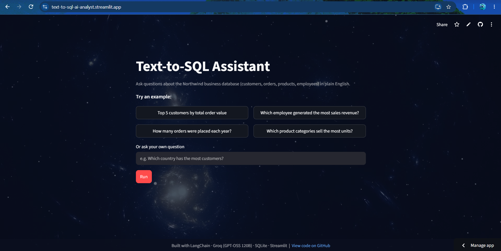

# 🧠 Text-to-SQL AI Analyst

**Ask a business question in plain English, and get the SQL, the answer and a chart in seconds.**

### 🔗 [Try the live demo →](https://text-to-sql-ai-analyst.streamlit.app)
*No setup or login needed. Click an example question to start.*



---

## 🎯 What it does

Non-technical teams often need data but can't write SQL. This app lets anyone ask questions like *"Who are our top 5 customers by revenue?"* and instantly see:

1. The **SQL query** the AI wrote, shown so the logic can be checked
2. The **results table** from a real business database
3. An **automatic chart** when the data suits one

## 📊 Results

| Metric | Result |
|---|---|
| Execution accuracy | **30/30** on a 30-question test set |
| Query types covered | Counts, aggregations, multi-table joins, subqueries |
| Database | Northwind (customers, orders, products, employees, suppliers) |

**How it was measured:** each test question has a verified reference query. An evaluation script runs both the app's SQL and the reference SQL and compares the **results**, not the query text, because different queries can be equally correct.

**What I learned:** the first run scored 29/30. When I investigated, the app's answer was actually correct; the *reference query* had an extra column the question didn't ask for. I fixed the test case. Evaluation sets can have bugs too, so I always inspect failures before trusting a score.

## 🛡️ Built to be safe

- Database opens in **read-only mode**, so it can never be modified
- Only **SELECT** queries are allowed to run
- Errors are caught and shown clearly instead of returning a wrong answer

## 🛠️ Skills demonstrated

- **SQL:** joins, aggregations, subqueries, date functions
- **GenAI / LLMs:** prompt design, LangChain, Groq API (GPT-OSS 120B)
- **Evaluation:** execution-accuracy testing, failure analysis
- **Python:** pandas, matplotlib, SQLite
- **Deployment:** Streamlit Community Cloud, secrets management, Git/GitHub

## 🏗️ How it works

```
Question → Read database schema → LLM writes SQL → Safety check → Run query → Table + Chart
```


---

<details>
<summary>⚙️ Run it locally (for developers)</summary>

```bash
git clone https://github.com/Vaibh31/text-to-sql-ai-analyst.git
cd text-to-sql-ai-analyst
python -m venv venv
venv\Scripts\activate        # Mac/Linux: source venv/bin/activate
pip install -r requirements.txt
```

Create a `.env` file with a free [Groq API key](https://console.groq.com):

```
GROQ_API_KEY=your_key_here
```

Run the app: `streamlit run app.py`
Run the evaluation: `python evaluate.py`

</details>